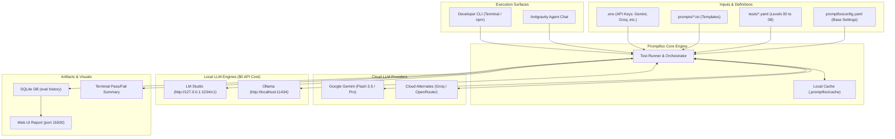
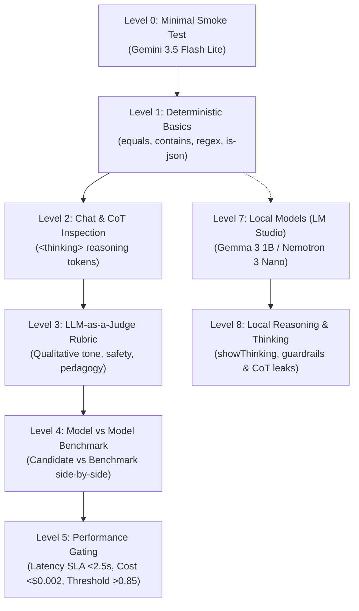

# Production LLM Evaluation Suite (Promptfoo + Gemini + Local Models)

A production-grade, zero-boilerplate LLM evaluation framework built with **[promptfoo](https://promptfoo.dev)**, default-configured for **Google Gemini 3.5 / 3.8 Flash & Pro**, and featuring out-of-the-box support for local models running via **LM Studio** and **Ollama**, as well as cloud providers (Groq, OpenRouter).

This project implements a progressive **"Easy to Hard" Evaluation Architecture (Levels 0 through 8)**, enabling AI engineers to test everything from smoke tests and zero-cost deterministic assertions to chain-of-thought leaks, local offline inference, LLM-as-a-judge rubrics, SLA latency/cost gating, and model-vs-model benchmarking.

---

## Architecture & Directory Layout

```text
.
├── .env.example                      # Provider API keys (Gemini, Groq, OpenRouter, Ollama)
├── README.md                         # Comprehensive architecture & execution guide
├── package.json                      # npm run eval:* automation scripts
├── promptfooconfig.yaml              # Core promptfoo evaluation configuration
├── prompts/
│   ├── basic.txt                     # Standard concise prompt template
│   ├── chain_of_thought.txt          # Enforced <thinking> and <answer> CoT template
│   └── comparison.txt                # Role-based prompt for model-vs-model battles
├── tests/
│   ├── 00_simple_eval.yaml           # Level 0: Minimal smoke test (geography & regex)
│   ├── 01_simple_assertions.yaml     # Level 1: Deterministic checks (equals, contains, regex, json)
│   ├── 02_thinking_chat.yaml         # Level 2: Chain-of-thought & multi-turn reasoning inspection
│   ├── 03_llm_rubric.yaml            # Level 3: Qualitative LLM-as-a-judge rubrics (tone, safety, pedagogy)
│   ├── 04_llm_vs_llm.yaml            # Level 4: Model vs. Model head-to-head benchmarking
│   ├── 05_cost_and_threshold.yaml    # Level 5: Latency SLAs, cost bounds & scoring thresholds
│   ├── 07_lm_studio.yaml             # Level 7: Local model evaluation via LM Studio (Gemma 3, Nemotron)
│   └── 08_thinking_lmstudio.yaml     # Level 8: Local reasoning & thinking trace inspection (LM Studio)
└── .antigravity/
    ├── skills/
    │   └── promptfoo-runner.md       # Antigravity skill for running & debugging evals
    └── agents/
        └── eval-assistant.md         # Autonomous AI Evaluations Engineer agent persona
```

---

## High-Level Architecture & Component Interaction



---

## Progressive Demo Story ("Easy to Hard")



| Level | Name | Target Engine | What it Assesses | Assertion Types Used | Cost |
| :--- | :--- | :--- | :--- | :--- | :--- |
| **Level 0** | **Minimal Smoke Test** | Gemini 3.5 Flash Lite | Sanity check provider connectivity, factual geography, and regex pattern matching. | `icontains`, `not-contains`, `regex` | **Free** ($0 judge cost) |
| **Level 1** | **Deterministic Basics** | Gemini 3.5 Flash Lite | Exact matching, keyword presence/absence, SemVer regex, and strict JSON object structure. | `equals`, `contains`, `icontains`, `not-contains`, `regex`, `is-json` | **Free** ($0 judge cost) |
| **Level 2** | **Chat & CoT Inspection** | Ollama / Gemini Flash | Internal reasoning visibility within `<thinking>...</thinking>` tags and answer tag separation. | `contains`, `regex`, `not-regex` | **Free** ($0 judge cost) |
| **Level 3** | **LLM-as-a-Judge Rubrics** | Ollama / Gemini Pro | Qualitative tone, empathetic customer de-escalation, polite refusal safety, and conceptual clarity. | `llm-rubric`, `not-contains` | Medium (Judge LLM) |
| **Level 4** | **Model vs. Model Benchmarking** | Side-by-Side (Ollama / Gemini) | Candidate vs Benchmark on complex logic, Go concurrency bugs, and distributed DB tradeoffs. | Multi-provider battle, `llm-rubric` | Medium (Dual generation + Judge) |
| **Level 5** | **Cost, Latency & Thresholds** | Ollama / Gemini Flash | Production SLA guardrails: Latency limits (<2,500ms), API spend caps (<$0.002), and rubric score thresholds (>=0.85). | `latency`, `cost`, `llm-rubric` (`threshold`), `javascript` | Low-Medium |
| **Level 7** | **Local Model (LM Studio)** | LM Studio (Gemma 3 1B / Nemotron) | Offline evaluation of local models: geography, custom JavaScript JSON validation, and math accuracy. | `icontains`, `javascript`, `regex` | **$0** (Local GPU/CPU) |
| **Level 8** | **Local Thinking & Reasoning** | LM Studio (Nemotron 3 Nano 4B) | Evaluates reasoning models with thinking traces (`showThinking: true`), markdown strip tolerance, and reasoning leak guardrails. | `javascript`, `regex`, `icontains`, `not-icontains` | **$0** (Local GPU/CPU) |

---

## Prerequisites & Node Version Troubleshooting

> [!IMPORTANT]
> **Node.js LTS Requirement**: `promptfoo` and its underlying database dependency `better-sqlite3` require an Active Node.js LTS release (**Node 20** or **Node 22**). Bleeding-edge Node versions (e.g., Node 25+) will fail to compile native V8 bindings (`no member named 'GetPrototype' in 'v8::Object'`).

If you encounter native build failures or are switching environments, follow these exact cleanup and switch steps:

```bash
# 1. Switch to Node 22 via nvm or fnm
nvm install 22 && nvm use 22

# 2. Clean up failed native build artifacts
rm -rf node_modules package-lock.json

# 3. Clean install
npm install

# 4. Run the first evaluation test
npm run eval:1

# 5. Launch the visual report
npm run view
```

---

## Quickstart

### 1. Prerequisites
- **Node.js**: Active LTS release (Node 20 or Node 22). Use the included `.nvmrc` (`nvm use`).
- **Gemini API Key**: Obtain from [Google AI Studio](https://aistudio.google.com/app/apikey) (for cloud Gemini runs).
- **Local Runners (Optional)**: [LM Studio](https://lmstudio.ai/) or [Ollama](https://ollama.com/) installed for local zero-cost evals.

### 2. Configure Environment
```bash
cp .env.example .env
```
Edit `.env` and add your Gemini API key (or leave blank if testing exclusively with local models):
```bash
GEMINI_API_KEY="your-actual-gemini-api-key"
```

### 3. Install Dependencies
```bash
npm install
```

---

## Running Evaluations

You can run individual levels step-by-step or evaluate the entire suite at once:

### Run By Progressive Level
```bash
# Level 0: Minimal Smoke Test
npm run eval:0

# Level 1: Deterministic Basics (Gemini 3.5 Flash Lite)
npm run eval:1

# Level 2: Chat & Chain-of-Thought Inspection
npm run eval:2

# Level 3: LLM-as-a-Judge Rubrics
npm run eval:3

# Level 4: Model vs. Model Head-to-Head
npm run eval:4

# Level 5: Cost, Latency & Threshold Gating
npm run eval:5

# Level 7: Local Model via LM Studio
npm run eval:7

# Level 7 (bypass cache for fresh local inference):
npm run eval:lmstudio

# Level 8: Local Reasoning & Thinking Trace Inspection (LM Studio)
npm run eval:8
```

### Run the Entire Suite
```bash
npm run eval:all
```

---

## Running Via Local Models

Running evaluations locally allows zero-cost testing, complete data privacy, offline execution, and evaluation of open-weights models.

### A. LM Studio

[LM Studio](https://lmstudio.ai/) provides an OpenAI-compatible local HTTP server for running GGUF models on macOS (Metal), Windows, or Linux.

#### 1. Setup in LM Studio
1. Open LM Studio and download your model of choice:
   - **Gemma 3 1B**: `google/gemma-3-1b`
   - **Nemotron 3 Nano 4B**: `nvidia/nemotron-3-nano-4b`
2. Navigate to the **Local Server** (or Developer) tab in LM Studio.
3. Select your model and click **Start Server**.
4. Verify the server is running on `http://127.0.0.1:1234` (OpenAI-compatible base URL: `http://127.0.0.1:1234/v1`).

#### 2. Configuration Pattern
In your test file (e.g., [`tests/07_lm_studio.yaml`](./tests/07_lm_studio.yaml)), configure the provider using promptfoo's `openai:chat` adapter:

```yaml
providers:
  - id: openai:chat:google/gemma-3-1b
    config:
      apiBaseUrl: http://127.0.0.1:1234/v1
      apiKey: lm-studio
      temperature: 0.1
```

#### 3. Thinking / Reasoning Traces (Level 8)
For reasoning models that generate internal chain-of-thought (e.g., `nvidia/nemotron-3-nano-4b`), configure reasoning flags in [`tests/08_thinking_lmstudio.yaml`](./tests/08_thinking_lmstudio.yaml):

```yaml
providers:
  - id: openai:chat:nvidia/nemotron-3-nano-4b
    config:
      apiBaseUrl: http://127.0.0.1:1234/v1
      apiKey: lm-studio
      temperature: 0.1
      showThinking: true        # Renders the reasoning trace in terminal & UI
      reasoning_effort: high    # Requests high thinking budget from reasoning endpoints
```

#### 4. Execute LM Studio Evals
```bash
# Run Level 7 basic local evaluation
npm run eval:7

# Run Level 7 without cache (forces fresh generation from the model)
npm run eval:lmstudio

# Run Level 8 thinking inspection & reasoning leak guardrails
npm run eval:8
```

---

### B. Ollama

[Ollama](https://ollama.com/) runs compact models locally via its native CLI and background daemon.

#### 1. Setup Ollama
```bash
# Install on macOS
brew install ollama

# Pull the model used in this suite (Llama 3.2 3B)
ollama pull llama3.2:3b

# Start the daemon (if not running as a desktop app)
ollama serve
```

By default, Ollama listens on `http://localhost:11434`.

#### 2. Configuration Pattern
Ollama is supported natively in promptfoo using the `ollama:chat` prefix. In [`tests/02_thinking_chat.yaml`](./tests/02_thinking_chat.yaml), [`tests/03_llm_rubric.yaml`](./tests/03_llm_rubric.yaml), [`tests/04_llm_vs_llm.yaml`](./tests/04_llm_vs_llm.yaml), and [`tests/05_cost_and_threshold.yaml`](./tests/05_cost_and_threshold.yaml), Ollama can serve as both the candidate and the judge:

```yaml
providers:
  - id: ollama:chat:llama3.2:3b
    config:
      temperature: 0.1

# Using Ollama as the qualitative judge model in Level 3:
defaultTest:
  options:
    provider:
      id: ollama:chat:llama3.2:3b
      config:
        temperature: 0.0
```

#### 3. Execute Ollama Evals
```bash
# Run Level 2 CoT inspection with Ollama
npm run eval:2

# Run Level 3 LLM-as-a-judge rubric evaluated locally by Ollama
npm run eval:3

# Run Level 4 side-by-side benchmark with Ollama
npm run eval:4

# Run Level 5 cost & latency SLA gating with Ollama
npm run eval:5
```

---

## Interactive Web UI & Reporting

Promptfoo includes a built-in web dashboard to inspect prompt outputs, view side-by-side model diffs, and review rubric judge evaluations:

```bash
# Start local web viewer on port 15500
npm run view

# Automatically open the web viewer in your default browser
npm run view:open

# Export standalone HTML report to output/report.html
npm run export

# Export JSON results to output/report.json
npm run export:json
```

Once started, open `http://localhost:15500` in your browser.

---

## Multi-Provider Configuration Guide

This project is configured out-of-the-box for **Google Gemini** and local models, but switching or combining providers requires only uncommenting provider blocks in [promptfooconfig.yaml](./promptfooconfig.yaml).

### 1. Google Gemini (Cloud Default)
```yaml
providers:
  - id: google:gemini-3.5-flash-lite
    label: "Gemini 3.5 Flash Lite (Fast Deterministic)"
    config:
      temperature: 0.1
      thinking:
        thinkingBudget: 0
  - id: google:gemini-3.5-flash
    label: "Gemini 3.5 Flash (Production Default)"
    config:
      temperature: 0.1
      maxOutputTokens: 2048
  - id: google:gemini-pro-latest
    label: "Gemini Pro Latest (Benchmark & Judge)"
    config:
      temperature: 0.2
      maxOutputTokens: 4096
```
*Required Env*: `GEMINI_API_KEY` and/or `GOOGLE_API_KEY`

### 2. LM Studio (Local OpenAI-Compatible Server)
```yaml
providers:
  - id: openai:chat:google/gemma-3-1b
    label: "LM Studio: Gemma 3 1B"
    config:
      apiBaseUrl: http://127.0.0.1:1234/v1
      apiKey: lm-studio
      temperature: 0.1
```
*Prerequisite*: LM Studio Local Server active on `http://127.0.0.1:1234`.

### 3. Local Ollama (Local Daemon)
```yaml
providers:
  - id: ollama:chat:llama3.2:3b
    label: "Local Ollama Llama 3.2 3B"
    config:
      temperature: 0.1
```
*Prerequisite*: `ollama serve` active with model pulled (`ollama pull llama3.2:3b`).

### 4. Groq (High-Speed Cloud Inference)
```yaml
providers:
  - id: groq:llama-3.3-70b-versatile
    label: "Groq Llama 3.3 70B"
    config:
      temperature: 0.2
```
*Required Env*: `GROQ_API_KEY`

### 5. OpenRouter (Multi-Model Gateway)
```yaml
providers:
  - id: openrouter:anthropic/claude-3.5-sonnet
    label: "OpenRouter Claude 3.5 Sonnet"
```
*Required Env*: `OPENROUTER_API_KEY`

---

## Antigravity IDE Integration

This project includes pre-configured Antigravity customizations:

- **[promptfoo-runner Skill](./.antigravity/skills/promptfoo-runner.md)**: Provides workflow instructions and CLI recipes when running tests from Antigravity.
- **[eval-assistant Agent](./.antigravity/agents/eval-assistant.md)**: An autonomous AI Evaluations Engineer persona ready to write new test cases, diagnose failed assertions, and optimize prompts.

You can trigger evals in the Antigravity Chat panel simply by asking:
> *"Run Level 1 deterministic evals with Gemini 3.5 Flash Lite."*
> *"Run Level 7 and test our local Gemma model in LM Studio."*
> *"Run Level 3 evals using Ollama as the local judge to test customer tone."*
> *"Inspect Level 8 thinking traces and check for reasoning leakage."*

---

## Evaluation Best Practices

1. **Start Deterministic (Levels 0 & 1)**: Test format, schema, required keywords, and regex pattern matching before paying for LLM judges.
2. **Inspect Thinking & Guardrails (Levels 2 & 8)**: Verify that chain-of-thought tokens stay contained within reasoning blocks and do not leak into customer-facing answers.
3. **Run Zero-Cost Evals Locally (Levels 7 & Ollama)**: Use local engines (LM Studio and Ollama) during iterative prompt development to iterate rapidly without incurring API billing or rate limits.
4. **Make Rubrics Concrete (Level 3)**: Avoid vague rubrics like *"Is this good?"*. Use multi-point numbered rubrics specifying tone, what must be present, and what is strictly prohibited.
5. **Guard Against Judge Bias (Level 5)**: Models often prefer longer answers. Pair `llm-rubric` with `latency` and word count limits (`type: javascript`) as demonstrated in Level 5.
6. **Isolate Test Failures**: Use `npx promptfoo eval --filter-description "<name>"` or `npx promptfoo eval --tests tests/01_simple_assertions.yaml` during iterative prompt engineering.
